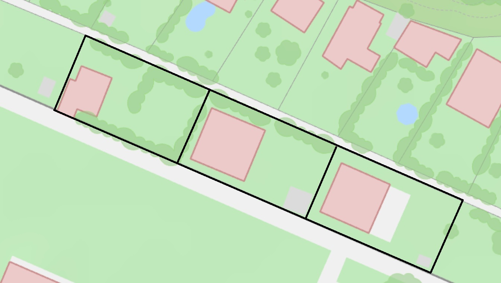

<!-- <!DOCTYPE HTML> -->
<html>

<!--  -->

<body>
	

<h3 style="font-size: value;text-align: center"> Es gibt ein paar Veränderungen im Dorf.

Schau was sich verändert hat! </h3>

<!-- width="276" height="367"  -->

<head/>
<body>

<h3 style="font-size: value;" id="picTwo"> Wie viele Zäune gibt es? <h3/>

 

<form action="/action_page.php">
  <label for="fname">Answer:</label>
  <input type="text" id="fname" name="fname">  
  <input type="submit" value="Submit">
</form>

 
  

  <!-- 
...After the script. user
 -->

<body/>

<html/>

