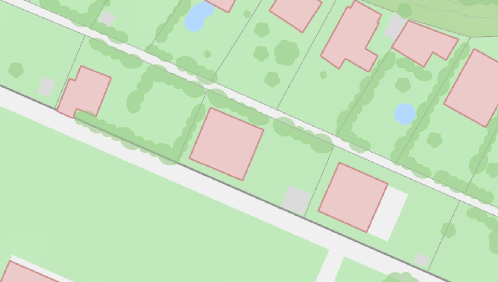

<html>
<body>
	

<h3 style="font-size: value;text-align: center"> Hier ist das Dorf Siebenschlaf mit einer ganz tollen Nachbarschaft. </h3>

<a href="https://peter-sutton.github.io/fence/item1div">
  <button> <h3 style="font-size: value;"> Next <h3/> <button/>
<a/>

  <!-- 
...After the script. user
 -->

<body/>
<html/>

